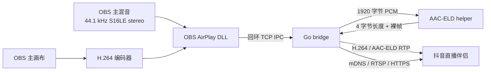

# 架构说明

本项目把 OBS 的编码视频和 PCM 主混音交给独立的 Go AirPlay bridge，再由一个独立的
C++ helper 完成 AAC-ELD 编码。目标接收端只有抖音直播伴侣的
`iOS投屏 → 无线投屏`。

## 进程边界

| 组件 | 语言 | 职责 |
|---|---|---|
| `obs-airplay-cast.dll` | C++17 / Qt6 | OBS 输出、H.264 编码器、主混音回调、设置窗口 |
| `obs-airplay-cast-bridge.exe` | Go | mDNS 发现、AirPlay、FairPlay、RTP、时钟和 helper 管理 |
| `obs-airplay-aac-eld.exe` | C++17 / libxaac | 接收 PCM，输出 AAC-ELD 裸帧 |

三个进程之间没有共享内存：

- OBS DLL 通过回环 TCP 向 bridge 发送数据。
- bridge 通过子进程 stdin/stdout 向 AAC helper 发送 PCM 并接收编码帧。
- AirPlay 的 TCP/UDP 流量只发往局域网接收端。

## 数据流

OBS DLL 不解码或重新采样 AirPlay 音频。它把 OBS 主混音转换成
44.1 kHz、16-bit、双声道交错 PCM，再附加 OBS 时间戳送给 bridge。

## OBS 侧

`src/airplay-cast.cpp` 注册了一个仅视频、编码数据模式的 OBS output：

1. 根据接收端画布和 OBS 主画布计算等比缩放尺寸。
2. 按 NVENC、QSV、x264 的顺序选择 H.264 编码器。
3. 以 CBR、每秒关键帧和 High profile 启动编码。
4. 注册第 0 轨主混音的 raw audio callback。
5. 把编码包和 PCM 分别交给 `AirPlayBridge`。

`src/plugin-main.cpp` 提供 `工具 → AirPlay 投屏...` 菜单和同一个窗口内的扫描、开始、
停止操作。接收端列表优先显示抖音设备。启用自动投屏后，插件在 OBS 完成加载时启动
单实例监控；未找到抖音接收端或会话断开时每秒轮询 bridge 的热 mDNS 缓存，找到后切回
主线程保存目标并启动投屏。投屏运行期间监控保持待命但不重复扫描。手动停止、OBS 退出
和插件卸载都会先解除自动监控并等待任务结束。

`AirPlayCast` 在运行期间每秒通过兼容的 IPC 状态查询检查 bridge 会话。bridge 监测
AirPlay 视频数据连接；接收端关闭或崩溃时返回 `disconnected`，插件随即停止 OBS 输出
和 bridge 会话，自动监控随后从 `Stopped` 状态重新扫描。

## Bridge 侧

Go bridge 启动时：

1. 创建 mDNS 缓存并在后台刷新。
2. 监听 `127.0.0.1` 的临时 TCP 端口。
3. 在 stdout 输出 `READY <port>`，OBS DLL 读取端口后连接。

每次会话中，bridge 完成以下步骤：

1. 按缓存的 mDNS 地址连接接收端，必要时重新扫描。
2. 执行 AirPlay pair-verify、FairPlay 和 SETUP。
3. 向 OBS 返回协商画布和音频编码。
4. 启动视频和音频流工作线程。
5. 音频选择 AAC-ELD 时，在第一次读取 PCM 帧时惰性启动 helper。

视频和音频使用同一个 OBS 单调时钟基准。插件在启动 OBS output 前发送一次
`clock` IPC，bridge 只在该会话内建立一次映射；断线后会话对象、队列和映射都会
重新创建，不复用上一轮时间基准。视频使用系统 PTS 映射到 bridge 的展示时间，
音频使用 44.1 kHz sample PTS 映射到同一会话时钟。

## 本机 IPC

每个 IPC 包包含 24 字节 little-endian 包头：

| 偏移 | 长度 | 字段 |
|---:|---:|---|
| 0 | 4 | magic `0x4f415043` |
| 4 | 2 | packet type |
| 6 | 2 | flags |
| 8 | 4 | payload length |
| 12 | 4 | reserved |
| 16 | 8 | OBS PTS，单位纳秒 |

主要包类型：

| 类型 | 名称 | 方向 |
|---:|---|---|
| 1 | start | OBS DLL → bridge |
| 2 | video | OBS DLL → bridge |
| 3 | audio | OBS DLL → bridge |
| 4 | stop | OBS DLL → bridge |
| 5 | clock | OBS DLL → bridge |
| 6 | discover | OBS DLL → bridge |
| 100 | response | bridge → OBS DLL |

payload 最大值由 bridge 限制为 32 MiB。视频 payload 可以是 Annex-B，也可以是四字节
大端长度前缀的 H.264 NAL 序列；bridge 会统一转换为 Annex-B。

当 AirPlay 视频 TCP 发送阻塞并填满 bridge 的 90 帧视频队列时，bridge 不再继续保留
旧参考链：当前 generation 的积压帧会被丢弃，只接受下一个 IDR 及其后续帧。音频队列
独立，并依据自身 PTS 丢弃已经错过播放 deadline 的帧。两个队列都保留原始时间戳，
不会用“收到时间”重新锚定，以避免网络恢复后出现持续的音画偏移。

## AAC-ELD helper 边界

helper 是长期存在的子进程，但只在实际需要编码第一帧音频时启动。这个惰性初始化是
协议链路的一部分：`NewExternalAudioCapture()` 创建对象时没有 helper，首次
`ReadFrameAt()` 必须创建 `eldEncoder` 并完成 `READY 480` 握手。

helper 的 stdio 协议见 [PROTOCOL.md](PROTOCOL.md)。

## 生命周期与关闭

- OBS 卸载插件时先停止 output，再关闭 bridge。
- 停止会话会取消流上下文、关闭 RTSP/媒体连接，并结束 helper。
- helper 关闭时先关闭 stdin，等待 2 秒；超时后才结束子进程。
- 安装新 DLL 前必须正常关闭 OBS，不能覆盖正在使用的插件文件。

## 日志边界

- OBS 日志记录插件加载、会话、编码器和时间轴信息。
- `%TEMP%\obs-airplay-cast-bridge.log` 记录 bridge 和协议调试信息。
- 抖音日志位于 `%APPDATA%\webcast_mate\logs`，属于接收端运行数据。

这些日志和 PCM/H.264 探针输出都可能包含设备名、IP、账号环境或隐私信息，均不得提交
到公开仓库。

## 不可回退的约束

- FairPlay 默认 `mixed`，不要按接收端是否声明新 feature 决定是否混合密钥。
- 抖音音频必须协商 AAC-ELD `ct=8/spf=480/audioFormat=0x1000000`。
- helper 必须输出裸帧，不能改成 ADTS。
- helper 路径按环境变量、bridge 同目录、当前工作目录的顺序发现。
- 外部音频捕获必须保留首次读取时的惰性编码器初始化。
